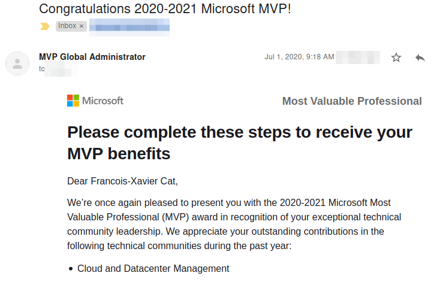

It's that time of the year! July 1st is the renewal date for all the Microsoft Most Valuable Professionals (MVPs).

I feel honored, proud and pleased to receive the Microsoft MVP award for another year for the category <b>Cloud and DataCenter Management MVP</b>!

> Dear Francois-Xavier, 
> We’re once again pleased to present you with the 2020-2021 Microsoft Most Valuable Professional (MVP) award in recognition of your exceptional technical community leadership. We appreciate your outstanding contributions in the following technical communities during the past year: 
>    Cloud and Datacenter Management

**I want to thank everyone for their support, the incredible Community and the teams at Microsoft** :bow:

{: loading="lazy" decoding="async"}

In the last year most my contributions were around:

* [Contributions to Open Source projects](https://github.com/lazywinadmin)
* [French PowerShell user group](https://frpsug.com/meet)

See my Microsoft MVP profile <a href="https://mvp.microsoft.com/en-us/PublicProfile/5000475" target="_blank">here</a>.

{: loading="lazy" decoding="async"}
